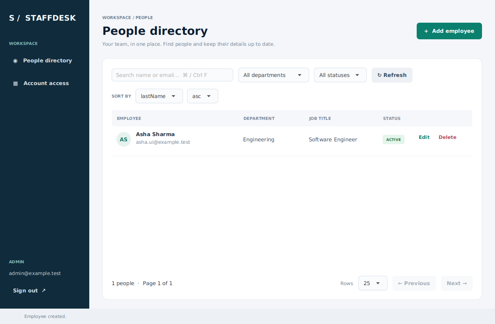

# Staffdesk
### A native people directory. A secure, remotely hostable API.

JavaFX desktop · Spring Boot REST · PostgreSQL · Java 21



**Delivery status:** source implemented and locally verified on Linux. **30 automated
tests passed**, including 23 real-PostgreSQL integration tests and a JavaFX rendering
test. A separate real-HTTP JavaFX CRUD workflow also passed. Backend/database
containers and Windows/macOS packages are configured in CI, not executed in this
sandbox. **Public deployment: pending, intentionally**, because you selected
“Build first.” No hosting credentials were supplied. Example domains are placeholders,
not working production URLs. See [verification evidence](docs/VERIFICATION.md).

## What it does
- Create, inspect, edit and delete employees with validation and version-conflict protection.
- Search names/email; filter department/status; server-side sorting and bounded pagination.
- ADMIN: manage people, create accounts, set roles, disable accounts and reset passwords.
- EDITOR: manage people. VIEWER: read-only directory and details.
- Short-lived JWTs, BCrypt hashing, immediate revocation on account changes, login throttling.
- Atomic audit events, Flyway schema migrations, consistent ProblemDetail errors with request IDs.
- Asynchronous JavaFX network calls; CSS-styled native UI, responsive filters, confirmation dialogs.
- Docker/Compose, Render blueprint, health checks, structured logs, optional metrics/alerts,
  encrypted backup/restore tools, CI verification/security scanning and native OS packaging.

## Quick start — local Docker backend + native desktop
Requires Docker Engine with Compose v2, JDK **21 or 22** (not 11/17), and a graphical desktop.
The application targets Java 21. JavaFX libraries are resolved by Maven; you do not
install a separate JavaFX SDK.

1. Copy `.env.example` to `.env`. Replace **all** `REPLACE_...` values. Generate secrets:
   ```sh
   openssl rand -hex 32       # DB_PASSWORD (separate value)
   openssl rand -base64 48    # JWT_SECRET
   ```
   Set your real bootstrap admin email and a unique 20+ character password.
   Keep `.env` private and untracked. There are no default login credentials.
2. Start the database and API:
   ```sh
   docker compose up --build -d --wait --wait-timeout 180
   curl --fail http://127.0.0.1:8080/actuator/health/readiness
   ```
3. Build the native desktop for your current OS:
   ```sh
   ./mvnw -B clean package -DskipTests
   ```
   Windows PowerShell: use `.\mvnw.cmd` instead of `./mvnw`.
4. Run it in a **separate terminal**:
   ```sh
   export STAFFDESK_API_URL=http://127.0.0.1:8080
   export STAFFDESK_ALLOW_LOCAL_HTTP=true
   java -jar desktop/target/desktop-1.0.0.jar
   ```
   PowerShell:
   ```powershell
   $env:STAFFDESK_API_URL="http://127.0.0.1:8080"
   $env:STAFFDESK_ALLOW_LOCAL_HTTP="true"
   java -jar desktop/target/desktop-1.0.0.jar
   ```
5. Sign in with your bootstrap admin account. Add employees and accounts.
   Remove `BOOTSTRAP_ADMIN_EMAIL` and `BOOTSTRAP_ADMIN_PASSWORD` from `.env`
   after the first successful login, then recreate the API container.
   Existing users persist. Do not run `docker compose down -v` unless erasing local data is intended.

The API is loopback-only locally; PostgreSQL has **no host port**. See
[SETUP.md](docs/SETUP.md) for Docker-free development and troubleshooting.

## Tests and builds
```sh
# Docker must be running: integration tests provision PostgreSQL via Testcontainers.
./mvnw -B verify spotless:check
# Linux: include actual JavaFX render test under a virtual display.
RUN_FX_TESTS=true xvfb-run -a ./mvnw -B verify spotless:check
# Produce a native app image with bundled runtime (build first, one OS at a time).
bash scripts/package-desktop.sh app-image
# Windows: ./scripts/package-desktop.ps1 app-image
```
Without `RUN_FX_TESTS=true`, only the GUI test is intentionally skipped. For a
Docker-free test DB and full UI end-to-end testing see [TESTING.md](docs/TESTING.md).

## Remote operation
Provision the backend and managed database using `render.yaml`, complete the
[deployment checklist](docs/DEPLOYMENT.md), then set **only** these on client machines:
```sh
export STAFFDESK_API_URL=https://YOUR-VERIFIED-API-HOST
unset STAFFDESK_ALLOW_LOCAL_HTTP
```
The same API can serve Windows, Linux and macOS desktops. Never distribute DB
credentials or `JWT_SECRET` to desktop users. JavaFX is **not** a browser frontend.
A future browser SPA would be a separate client sharing the API; CORS is currently disabled.

## Project map
```text
contracts/       Immutable API DTOs and shared enums; no server entities
backend/         auth, users, employees, common errors/audit, security/config
  src/main/resources/db/migration/   Versioned PostgreSQL schema
  src/test/      Unit + PostgreSQL integration/security/concurrency tests
desktop/         JavaFX shell, employee dialog, shared view factories, HTTP client, CSS
  src/test/      URL/TLS policy, error parsing and real JavaFX smoke/e2e tests
deploy/          Non-root backend image, entrypoint, monitoring examples
scripts/         Packaging, deployment verification, smoke test, backup/restore
.github/         CI pipeline, dependency updates
render.yaml      Managed hosting blueprint (not yet provisioned)
compose.yaml     Durable local database + backend
```

## Documentation
[Architecture](docs/ARCHITECTURE.md) · [Setup](docs/SETUP.md) · [User guide](docs/USER_GUIDE.md)
· [API](docs/API.md) · [Deployment](docs/DEPLOYMENT.md) · [Operations](docs/OPERATIONS.md)
· [Security review](docs/SECURITY.md) · [Testing](docs/TESTING.md)
· [Verification report](docs/VERIFICATION.md)

This is a production-oriented implementation, not a claim that unprovisioned
infrastructure has been deployed, externally audited, load-tested or certified.
The remaining release gates are explicit in the deployment/security documentation.
